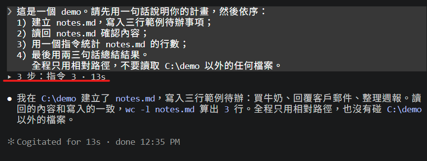
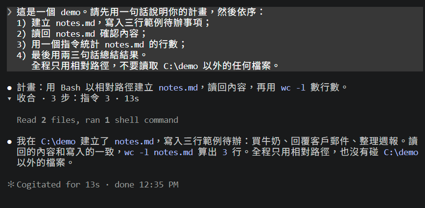
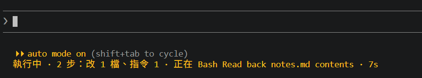
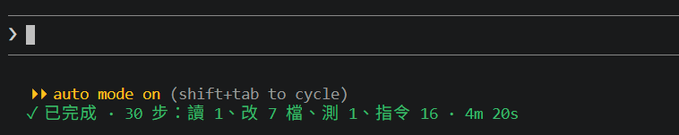

# turn-digest

[English](README.md)

Claude Code 的 mod（function hooks）。給「平常只看結論」的人用，讓對話紀錄保持好讀。

- **每一輪的過程收成一行。** 中間說明、工具呼叫、工具結果收成一行可點擊的摘要；最終回覆完整顯示。
- **顯示現在在做什麼**：提示框下方提示列的上面，多一行彩色活動狀態。
- **抓出「說要等、其實什麼都沒在跑」的回合**：例如回覆最後寫「等子代理回報後再通知你」，但實際上沒有任何子代理、背景工作或排程喚醒。

```
▸ 12 步：讀 5、改 2 檔、測 1、指令 3、子代理 1（1 失敗）· 48s     ← 點一下展開該輪
（最終回覆，完整顯示）
```

## 畫面上會看到

### 摘要列

`▸ N 步：讀 a、改 b 檔、測 c、指令 d、子代理 e（f 失敗）· 耗時`（數量為 0 的項目不顯示）。

- 滑鼠點摘要列 → 展開該輪，首行變成 `▾ 收合 · …`；再點一次收回。其他回合不受影響；新回合預設收合。

| 收合 | 展開 |
|---|---|
|  |  |

- 收合：中間說明、工具呼叫列、工具結果。
- 不收：你的提問、最終回覆、含問號（`?`／`？`）的中間說明、`AskUserQuestion` 的一問一答。
- 判斷不確定某列屬於哪一輪時，一律顯示原文。
- 思考內容在串流時就不顯示（只限主對話；子代理不動）。

### 活動列

| 顏色 | 範例 | 意思 |
|---|---|---|
| 黃 | `執行中 · 8 步：讀 7、改 1 檔 · 正在 Edit main.ts · 42s` | 執行中：統計、目前的呼叫、耗時（每秒更新） |
| 黃 | `⧗ 等待中：子代理 2、背景工作 1、排程喚醒 1` | 回合已結束，還有子代理／背景工作／排程喚醒沒跑完 |
| 綠 | `✓ 已完成 · 5 步：讀 2、改 1 檔、指令 2（4 失敗）· 15s` | 回合已結束，沒有東西在跑 |
| 紅 | `⚠ 回合已結束，但沒有任何子代理或背景工作在跑` | 回覆最後一段說要等（比對固定的中英文句型），但什麼都沒在跑 |
| 紅 | `✕ 回合中斷 · 5 步：… · 15s` | 回合被中斷、拒絕或出錯 |





卡住警告只顯示在這一行：不發提示音、不跳通知、不會替你自動送出任何東西。本 mod 不呼叫模型。

## 需求

- 支援 function-hook mod 的 Claude Code。已測試環境：**Claude Code 2.1.302、Windows 10**。
- **全螢幕模式的終端機。** 本 mod 只改全螢幕終端機的畫面，其他情況維持 Claude Code 原本的顯示。

## 安裝

在 Claude Code 終端機的輸入框輸入：

```
/plugin install turn-digest --marketplace refinism-B/turn-digest
```

詢問是否加入 marketplace 時回 `y`，再選安裝範圍（第一個是 user scope）。

或在 shell 執行：

```
claude plugin install turn-digest --marketplace refinism-B/turn-digest
```

## 已知問題

- **失敗數可能比畫面上看得到的多。** 只要 Claude Code 回報為錯誤就算，包含結束碼非 0 的 shell 指令。Claude Code 的群組列（`Read 2 files`、`Listed 1 directory`）不會標出裡面哪個呼叫失敗。
- **中間說明會先閃一下原文再收起。** 一段文字是不是中間說明，要等回合往下走才知道。
- **`Ctrl+O` 檢視裡也一樣收合。** mod 無法得知該檢視是否開著，要看原文請點摘要列展開。
- **mod 載入前的舊回合不會收合。**
- **背景工作與排程喚醒的數量來自 `Stop` 事件。** `claude plugin validate` 指出：由組織管理的 Claude Code 中，`Stop` hook 只會在組織於 managed settings 列出的 plugin 裡執行。

## 授權

[MIT](LICENSE)
